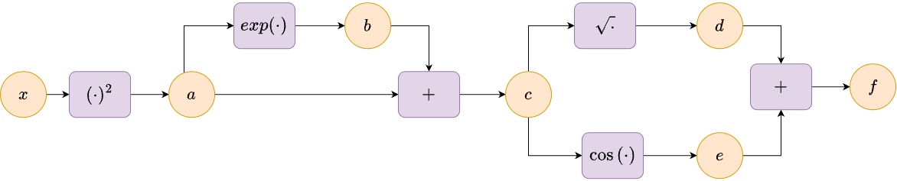
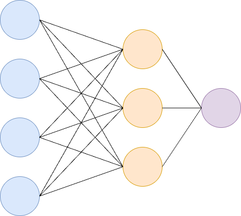

## Lecture Overview

Calculus is the branch of mathematics focused on the study of continuous change.

The core concepts of calculus are limits, derivatives, and integrals.

We will need these concepts in our future understanding of:

- Optimization
- Probability

## Lecture Objectives

Review:

- Limits and single variable derivatives
<!-- - Sequences and geometric series -->
- Derivative rules, including the chain rule
- Taylor series and Taylor's Theorem
- Partial derivatives, gradients, Jacobians, and matrix calculus
- Automatic differentiation and back-propagation
- Hessians and the multivariate Taylor series

## Why Derivatives?

Training a model typically means solving $\min_{w} \mathcal{L}(w)$, where $\mathcal{L}$ is a loss function and $w$ are the model parameters.

:::: {.incremental}
- Gradient descent: $w_{k+1} = w_{k} - \alpha \nabla \mathcal{L}(w_{k})$ requires the **gradient**. Back-propagation computes it with the **chain rule**.
- Newton's method: $w_{k+1} = w_{k} - \nabla^{2} \mathcal{L}(w_{k})^{-1}\nabla \mathcal{L}(w_{k})$ requires the **Hessian**.
- To understand *why* these methods work, we use **Taylor's theorem**.
::::

## Limits

The limit of a function $f(x)$ is defined as

$$
\lim_{x\rightarrow c} f(x) = L.
$$

This definition means that the function $f(x)$ approaches the limit $L$ as $x$ approaches the value $c$.

The value of $L$ need not be finite (e.g., $\lim_{x\rightarrow 0^{+}}\log(x) = -\infty$).

## Derivative Definition

The derivative $f^{\prime}(x)$ of single-variable real-valued function $f(x)$ at the point $x$ is

$$
f^{\prime}(x) = \lim_{h\rightarrow 0} \frac{f(x+h)-f(x)}{h}.
$$

Functions for which the derivative exists over their defined domain are called *differentiable*.

---

Other common notations for a derivative are

$$
f^{\prime}(x) = \frac{d}{dx}f(x) = \frac{df}{dx}.
$$


---

```{python}
#| fig-align: center
import numpy as np
import matplotlib.pyplot as plt

# Define the function and its derivative
def f(x):
  return x**2

def df(x):
  return 2*x

# Point to illustrate derivative
x0 = 1.5
h = 0.5

# Compute slope using definition
slope_secant = (f(x0 + h) - f(x0)) / h
slope_tangent = df(x0)

# Plot function
x = np.linspace(0, 3, 100)
y = f(x)

plt.figure(figsize=(8, 5))
plt.plot(x, y, label='$f(x) = x^2$')

# Secant line
x_secant = np.array([x0, x0 + h])
y_secant = f(x_secant)
plt.plot(x_secant, y_secant, 'ro-', label=r'$(f(x_{0}+h)-f(x_{0}))/h$')

# Tangent line at x0
tangent_line = slope_tangent * (x - x0) + f(x0)
plt.plot(x, tangent_line, 'g--', label=r'$f^{\prime}(x_{0})$')

plt.scatter([x0], [f(x0)], color='black', zorder=5)
plt.text(x0, f(x0)+0.5, f'$x_0={x0}$', ha='center')

plt.xlabel('$x$')
plt.ylabel('$f(x)$')
plt.legend()
plt.title('Derivative as Slope: Secant and Tangent Lines')
plt.grid(True)
plt.show()
```

## The Derivative as a Linear Approximation

Rearranging the definition, for small $h$ we have $f(x+h) \approx f(x) + f^{\prime}(x)h$.

The tangent line is the **best linear approximation** of $f$ near $x$: the error goes to zero *faster* than $h$,

$$
\lim_{h\rightarrow 0}\frac{f(x+h) - f(x) - f^{\prime}(x)h}{h} = 0.
$$

This idea (approximate $f$ locally by a simple polynomial) leads to both the chain rule and Taylor's theorem.

## Derivative Rules

| $f(x)$ | $f^{\prime}(x)$ |
|:---:|:---:|
| $x^{n}$ (power rule, any real $n$) | $nx^{n-1}$ |
| $e^{x}$ | $e^{x}$ |
| $\log(x)$, $x>0$ | $\frac{1}{x}$ |
| $\sin(x)$ | $\cos(x)$ |
| $\cos(x)$ | $-\sin(x)$ |

Note that $\log$ denotes the natural logarithm.

## Combination Rules

For differentiable functions $f(x)$ and $g(x)$ and a constant $c$

$$
\small
\begin{align}
(f(x) \pm g(x))^{\prime} &= f^{\prime}(x) \pm g^{\prime}(x), \\
(cf(x))^{\prime} &= cf^{\prime}(x), \\
(f(x)g(x))^{\prime} &= f^{\prime}(x)g(x) + f(x)g^{\prime}(x), \\
\left(\frac{f(x)}{g(x)}\right)^{\prime} &= \frac{f^{\prime}(x)g(x) - f(x)g^{\prime}(x)}{(g(x))^{2}}, \quad g(x)\neq 0.
\end{align}
$$

---

How do we calculate derivatives of more complex functions, such as, $f(x) = 10x^{2} - 3x^{6} - x^{-\frac{3}{2}}?$

:::: {.fragment}
$$
f^{\prime}(x) = 20x - 18x^{5} + \frac{3}{2}x^{-\frac{5}{2}}.
$$
::::

## Chain Rule

For differentiable functions $f(x)$ and $g(x)$

$$
\left(f(g(x))\right)^{\prime} = f^{\prime}(g(x))g^{\prime}(x).
$$

Equivalently, in Leibniz notation,

$$
\frac{d}{dx}f(g(x)) = \frac{df}{dg}\frac{dg}{dx}.
$$

:::: {.fragment}
**Key idea:** the derivative of a composition is the *product* of the derivatives of its pieces. A neural network is a composition of simple functions, so its derivative is a product.
::::

---

**Example:** The sigmoid function $\sigma(x) = \frac{1}{1+e^{-x}}$ is widely used in machine learning (e.g., logistic regression).

Show that $\sigma^{\prime}(x) = \sigma(x)(1-\sigma(x))$.

::: {.notes}
Write $\sigma(x) = (1+e^{-x})^{-1}$. By the chain rule
$$
\sigma^{\prime}(x) = -(1+e^{-x})^{-2}\cdot(-e^{-x}) = \frac{e^{-x}}{(1+e^{-x})^{2}} = \frac{1}{1+e^{-x}}\cdot\frac{e^{-x}}{1+e^{-x}} = \sigma(x)(1-\sigma(x)).
$$
:::

## Higher-Order Derivatives

We can define second- and higher-order derivatives using our definitions. The following is a second derivative:

$$
f^{\prime\prime}(x) = \frac{d^{2}}{dx^{2}} f(x) = \lim_{h\rightarrow 0} \frac{f^{\prime}(x+h)-f^{\prime}(x)}{h}.
$$

For higher-order derivatives we have

$$
f^{(n)}(x) = \frac{d^{n}}{dx^{n}}f(x).
$$

## Partial Derivatives

We can extend the concept of a derivative to functions of 2 or more variables. Consider a real-valued function $f(x,y)$.

The partial derivative of $f$ with respect to $x$ is

$$
\small
\frac{\partial}{\partial x}f(x,y) = f_{x}(x, y) = \lim_{h\rightarrow 0} \frac{f(x+h, y) - f(x,y)}{h}.
$$

Similarly, the partial derivative of $f$ with respect to $y$ is

$$
\small
\frac{\partial}{\partial y}f(x,y) = f_{y}(x, y) = \lim_{h\rightarrow 0} \frac{f(x, y+h) - f(x,y)}{h}.
$$

---

For a real-valued function $f: \mathbb{R}^{n} \rightarrow \mathbb{R}$ the $i$th partial derivative is

$$
\scriptsize
\frac{\partial}{\partial x_{i}}f(x_{1},\ldots,x_{n}) = \lim_{h\rightarrow 0} \frac{f(x_{1},\dots, x_{i}+h,\ldots, x_{n}) - f(x_{1},\ldots, x_{n})}{h}
$$

## Taylor Series

The linear approximation uses $f^{\prime}$. Higher-order derivatives let us build better polynomial approximations.

The Taylor series of a real function $f(x)$ that is infinitely differentiable at a real number $c$ is the infinite *power series*

$$
\sum_{n=0}^{\infty}\frac{f^{(n)}(c)(x-c)^{n}}{n!}.
$$

For many functions of interest (e.g., $e^{x}$, $\sin(x)$, $\cos(x)$) this series converges to $f(x)$, but this is not guaranteed for every infinitely differentiable function.

---

If we let $f(x)=e^{x}$ and $c=0$ we obtain the famous formula (valid for all $x\in\mathbb{R}$)

$$
e^{x}= \sum_{n=0}^{\infty}\frac{x^{n}}{n!}.
$$

---

```{python}
#| fig-align: center
import numpy as np
import matplotlib.pyplot as plt
from math import factorial

x = np.linspace(-3, 3, 400)

plt.figure(figsize=(8, 5))
plt.plot(x, np.exp(x), 'k', lw=2.5, label='$e^{x}$')

# Taylor polynomials of e^x about c = 0
for k in [1, 2, 3, 5]:
    Tk = sum(x**n / factorial(n) for n in range(k + 1))
    plt.plot(x, Tk, '--', label=f'degree {k}')

plt.scatter([0], [1], color='black', zorder=5)
plt.ylim(-2, 15)
plt.xlabel('$x$')
plt.ylabel('$f(x)$')
plt.legend()
plt.title('Taylor Polynomials of $e^{x}$ about $c=0$')
plt.grid(True)
plt.show()
```

The approximations are excellent near $c$ and degrade as we move away from it.

## Taylor's Theorem

Let $k\geq 1$ be an integer and let the function $f:\mathbb{R}\rightarrow \mathbb{R}$ be $k$ times differentiable at the point $c\in\mathbb{R}$. Then there exists a remainder function $r_{k}:\mathbb{R}\rightarrow \mathbb{R}$ such that

$$
\small
f(x) = \sum_{n=0}^{k} \frac{f^{(n)}(c)(x-c)^{n}}{n!} + r_{k}(x)(x-c)^{k},
$$
and

$$
\small
\lim_{x\rightarrow c}r_{k}(x) = 0.
$$

---

In optimization we mostly use $k=1$ and $k=2$. Writing $x = c + p$ for a small step $p$:

$$
\begin{align}
f(c+p) &\approx f(c) + f^{\prime}(c)p, \\
f(c+p) &\approx f(c) + f^{\prime}(c)p + \frac{1}{2}f^{\prime\prime}(c)p^{2}.
\end{align}
$$

:::: {.fragment}
- Gradient descent is built on the linear model.
- Newton's method is built on the quadratic model.
::::

## Gradients

Given a real-valued function $f(x)$ with $x\in\mathbb{R}^{n}$, the gradient is a vector consisting of all partial derivatives of $f$:

$$
\nabla f(x) = 
\begin{bmatrix}
\frac{\partial}{\partial x_{1}}f(x) \\
\frac{\partial}{\partial x_{2}}f(x) \\
\vdots \\
\frac{\partial}{\partial x_{n}}f(x) \\
\end{bmatrix}.
$$

---

**Example** $f(x_{1},x_{2})= \sin(x_{1})\cos(x_{2})$

Calculate $\nabla f(x_{1},x_{2})$:

::: {.notes}
$$
\begin{align*}
f(x_{1}, x_{2}) &= \sin(x_{1})\cos(x_{2}) \\
\frac{\partial f}{\partial x_{1}} &= \cos(x_{1})\cos(x_{2}) \\
\frac{\partial f}{\partial x_{2}} &= -\sin(x_{1})\sin(x_{2}) \\
\nabla f(x_{1}, x_{2}) &=
\begin{bmatrix}
\cos(x_{1})\cos(x_{2}) \\
-\sin(x_{1})\sin(x_{2})
\end{bmatrix}
\end{align*}
$$
:::

## Directional Derivatives

The linear approximation generalizes to $f:\mathbb{R}^{n}\rightarrow\mathbb{R}$:

$$
f(x+p) \approx f(x) + \nabla f(x)^{\top}p.
$$

The rate of change of $f$ in the direction of a unit vector $u$ is the *directional derivative*

$$
D_{u}f(x) = \lim_{h\rightarrow 0}\frac{f(x+hu)-f(x)}{h} = \nabla f(x)^{\top}u.
$$

:::: {.fragment}
You have a homework problem to determine which direction $u$ increases $f$ the fastest.
::::

## Vector-Valued Functions

A vector-valued function $f: \mathbb{R}^{n}\rightarrow \mathbb{R}^{m}$ is a mapping from $n$-dimensional space to $m$-dimensional space

$$
f(x) =
\begin{bmatrix}
f_{1}(x) \\
f_{2}(x) \\
\vdots \\
f_{m}(x) \\
\end{bmatrix}\in\mathbb{R}^{m}.
$$

The rules for differentiation apply to each of the functions $f_{i}(x)$.

## The Jacobian

The derivative of $f: \mathbb{R}^{n}\rightarrow \mathbb{R}^{m}$ is the matrix

$$
\small
J =
\frac{df}{dx}
=
\begin{bmatrix}
\frac{\partial f_{1}}{\partial x_{1}} & \frac{\partial f_{1}}{\partial x_{2}} & \cdots & \frac{\partial f_{1}}{\partial x_{n}} \\
\frac{\partial f_{2}}{\partial x_{1}} & \frac{\partial f_{2}}{\partial x_{2}} &\cdots & \frac{\partial f_{2}}{\partial x_{n}} \\
\vdots & \vdots & \ddots & \vdots\\
\frac{\partial f_{m}}{\partial x_{1}} &\frac{\partial f_{m}}{\partial x_{2}} & \cdots & \frac{\partial f_{m}}{\partial x_{n}}
\end{bmatrix}\in\mathbb{R}^{m\times n}.
$$

This matrix is called the *Jacobian*. It describes the rate of change of each output w.r.t. each input and gives the best linear approximation $f(x+p) \approx f(x) + Jp$.

---

**Example:** $f(x_{1},x_{2}) = \begin{bmatrix} \sin(x_{1}x_{2}) \\ 4x_{1}^{2}e^{x_{1}x_{2}} \end{bmatrix}$

::: {.notes}
$$
\begin{align*}
f(x_{1},x_{2}) &=
\begin{bmatrix}
\sin(x_{1}x_{2}) \\
4x_{1}^{2}e^{x_{1}x_{2}}
\end{bmatrix} \\[1em]
J = \frac{df}{dx} &=
\begin{bmatrix}
\frac{\partial}{\partial x_{1}}\sin(x_{1}x_{2}) & \frac{\partial}{\partial x_{2}}\sin(x_{1}x_{2}) \\[0.5em]
\frac{\partial}{\partial x_{1}}4x_{1}^{2}e^{x_{1}x_{2}} & \frac{\partial}{\partial x_{2}}4x_{1}^{2}e^{x_{1}x_{2}}
\end{bmatrix} \\[1em]
&=
\begin{bmatrix}
x_{2}\cos(x_{1}x_{2}) & x_{1}\cos(x_{1}x_{2}) \\[0.5em]
8x_{1}e^{x_{1}x_{2}} + 4x_{1}^{2}x_{2}e^{x_{1}x_{2}} & 4x_{1}^{3}e^{x_{1}x_{2}}
\end{bmatrix}
\end{align*}
$$
:::

## Jacobian of $Ax$

Let $f(x) = Ax$, where $A\in\mathbb{R}^{m\times n}$ and $x\in\mathbb{R}^{n}$. What is $\frac{df}{dx}$?

::: {.notes}
$$
f_{i}(x) = \sum_{j=1}^{n}A_{ij}x_{j} \quad\Rightarrow\quad \frac{\partial f_{i}}{\partial x_{j}} = A_{ij} \quad\Rightarrow\quad \frac{df}{dx} = A\in\mathbb{R}^{m\times n}.
$$
:::

## Numerator vs. Denominator Layout

For $y=f(x)$ with $y\in\mathbb{R}^{m}$ and $x\in\mathbb{R}^{n}$, there are two common conventions for the shape of $\frac{dy}{dx}$:

- **Numerator layout:** $\frac{dy}{dx}\in\mathbb{R}^{m\times n}$ (rows indexed by $y$, columns by $x$), as for the Jacobian above.
- **Denominator layout:** $\frac{dy}{dx}\in\mathbb{R}^{n\times m}$, the transpose.

We use **numerator layout** throughout. It is standard in neural network and automatic differentiation contexts, and Jacobians compose by ordinary matrix multiplication, matching the chain rule.

::: {.notes}
For the special case of the gradient of a scalar function $f(x)\in\mathbb{R}$, numerator layout would technically give a *row* vector. Instead, by the near-universal convention in optimization and machine learning, we write $\nabla f(x)$ as a *column* vector matching the shape of $x$ -- formally $\nabla f(x) := J_{f}(x)^{\top}$ -- so that updates like $x \leftarrow x - \alpha \nabla f(x)$ are well-defined.
:::

## Multivariate Chain Rule

Let $g:\mathbb{R}^{n}\rightarrow\mathbb{R}^{m}$ and $f:\mathbb{R}^{m}\rightarrow\mathbb{R}^{p}$ be differentiable and $h(x) = f(g(x))$. Then

$$
\underbrace{\frac{dh}{dx}}_{p\times n} = \underbrace{\frac{df}{dg}}_{p\times m}\,\underbrace{\frac{dg}{dx}}_{m\times n}.
$$

The Jacobian of a composition is the **product of the Jacobians**, exactly as in the single variable case.

---

Writing out a single entry of the matrix product:

$$
\frac{\partial h_{i}}{\partial x_{j}} = \sum_{k=1}^{m}\frac{\partial f_{i}}{\partial g_{k}}\frac{\partial g_{k}}{\partial x_{j}}.
$$

:::: {.fragment}
**Sum over paths:** if $x_{j}$ influences $h_{i}$ through several intermediate variables $g_{k}$, we add the contributions of each path.
::::

---

For example, if $x\in\mathbb{R}$, $g(x) = (g_{1}(x), g_{2}(x))$, and $h(x) = f(g_{1}(x), g_{2}(x))$, then

$$
\frac{dh}{dx} = \frac{\partial f}{\partial g_{1}}\frac{dg_{1}}{dx} + \frac{\partial f}{\partial g_{2}}\frac{dg_{2}}{dx}.
$$


## Useful Identities for Computing Gradients

$$
\begin{align}
\frac{d(Ax)}{dx} &= A, \quad
\frac{d(x^{\top}A)}{dx} = A^{\top}, \\
\frac{d(x^{\top}a)}{dx} &= a, \quad
\frac{d(a^{\top}x)}{dx} = a, \\
\frac{d(a^{\top}Xb)}{dX} &= ab^{\top}, \quad
\frac{d(x^{\top}Ax)}{dx} = (A + A^{\top})x. \\
\end{align}
$$

::: {.notes}
The first two identities are genuine Jacobians (vector-valued output), in numerator layout. The last four are gradients of scalar-valued functions, written with the same shape as the variable by convention (a column vector for $x$, a matrix for $X$).
:::

## Jacobian Dimensions

Observe that

:::: {.incremental}
- Jacobian of a scalar-valued function $f(x)$ where $x\in\mathbb{R}^{n}$ is a $1\times n$ row vector, whose transpose is the gradient $\nabla f(x)\in\mathbb{R}^{n}$.
- Jacobian of a vector-valued function $f(x)$ where $x\in\mathbb{R}^{n}$ and $f\in\mathbb{R}^{m}$ is a matrix $J\in\mathbb{R}^{m\times n}$.
- What is the Jacobian of a matrix-valued function?
::::

## Tensors

Tensors are a generalization of vectors and matrices to multidimensional arrays.

Tensors arise naturally in deep learning applications.

An $n$-dimensional tensor is an array

$$
\mathcal{A}\in\mathbb{R}^{I_{1}\times I_{2}\times \cdots \times I_{n}}.
$$

---

An example of a 3rd order tensor is an RGB image which is an array

$$
\mathcal{A}\in\mathbb{R}^{m\times n \times 3}.
$$

## Gradients of Matrices

It is possible that we have a function mapping:

$$
f: \mathbb{R}^{m\times n} \rightarrow \mathbb{R}^{p\times q}.
$$

Let $B = f(A)$. For a linear mapping we can express this as the multiplication of a $4$th order tensor $T\in\mathbb{R}^{p\times q\times m\times n}$ with the matrix $A$,

$$
B_{ij} = \sum_{k=1}^{m}\sum_{l=1}^{n}T_{ijkl}A_{kl}.
$$

---

Alternatively, we could *flatten* the matrices, $A$ and $B$ so that they become vectors $\tilde{A}\in\mathbb{R}^{mn}$ and $\tilde{B}\in\mathbb{R}^{pq}$. The $4$th order tensor $T$ can also be flattened into a matrix $\tilde{T}\in\mathbb{R}^{pq\times mn}$ and we can compute

$$
\tilde{B} = \tilde{T}\tilde{A}.
$$

The vector $\tilde{B}$ can be *unflattened* into a matrix of size $p\times q$.

---

Let $A\in\mathbb{R}^{m\times n}$ depend on $B\in\mathbb{R}^{p\times q}$. How can we compute the derivative $\frac{dA}{dB}$?

The result of this operation is a $4$-dimensional tensor

$$
J\in\mathbb{R}^{m\times n \times p \times q}, \quad J_{ijkl} = \frac{\partial A_{ij}}{\partial B_{kl}}.
$$

In numerator layout the output indices come first, followed by the input indices.

## Gradient of Vector w.r.t. Matrix

Let's compute $\frac{df}{dA}\in\mathbb{R}^{m\times m\times n}$ when $f=Ax\in\mathbb{R}^{m}$, where $A\in\mathbb{R}^{m\times n}$, and $x\in\mathbb{R}^{n}$.

$$
\frac{df}{dA}
=
\begin{bmatrix}
\frac{df_{1}}{dA}\\
\frac{df_{2}}{dA}\\
\vdots \\
\frac{df_{m}}{dA}\\
\end{bmatrix}
$$

---

Compute $\frac{\partial f_{k}}{\partial A_{ij}}$:

We will use the *Kronecker delta*: $\delta_{ki} = 1$ if $k=i$ and $\delta_{ki} = 0$ otherwise.

::: {.notes}
$$
\begin{align*}
f &= Ax \\
f_{k} &= \sum_{l=1}^{n} A_{kl} x_{l} \\
\frac{\partial f_{k}}{\partial A_{ij}} &= \frac{\partial}{\partial A_{ij}} \left( \sum_{l=1}^{n} A_{kl} x_{l} \right) \\
&= \sum_{l=1}^{n} \frac{\partial A_{kl}}{\partial A_{ij}} x_{l} \\
&= \sum_{l=1}^{n} \delta_{ki}\delta_{lj} x_{l} \\
&= \delta_{ki} x_{j}
\end{align*}
$$
:::

---

$$
\frac{\partial f_{k}}{\partial A_{ij}} = \delta_{ki}x_{j}
$$

:::: {.incremental}
- The tensor is mostly zeros: $f_{k}$ only depends on row $k$ of $A$.
- In practice $f=Ax$ feeds into a **scalar** loss $\mathcal{L}(f)$. By the chain rule
$$
\frac{\partial \mathcal{L}}{\partial A_{ij}} = \sum_{k=1}^{m}\frac{\partial \mathcal{L}}{\partial f_{k}}\frac{\partial f_{k}}{\partial A_{ij}} = \sum_{k=1}^{m}\frac{\partial \mathcal{L}}{\partial f_{k}}\delta_{ki}x_{j} = \frac{\partial \mathcal{L}}{\partial f_{i}}x_{j}.
$$
::::

---

:::: {.incremental}
- In matrix form: $\nabla_{A}\mathcal{L} = \left(\nabla_{f}\mathcal{L}\right)x^{\top}\in\mathbb{R}^{m\times n}$, an outer product with the same shape as $A$.
- We never need to form the $3$rd order tensor. This formula is used for every weight matrix in back-propagation.
::::

## Gradient of a Matrix w.r.t. a Matrix

Let $R\in\mathbb{R}^{m\times n}$ and $K=R^{\top}R\in\mathbb{R}^{n\times n}$. What is $\frac{dK}{dR}$?


:::: {.fragment}
Compute $\frac{\partial K_{pq}}{\partial R_{ij}}$
::::

::: {.notes}
$$
K_{pq} = \sum_{l=1}^{m} R_{lp}R_{lq}, \qquad
\frac{\partial K_{pq}}{\partial R_{ij}} = \sum_{l=1}^{m}\left(\delta_{li}\delta_{pj}R_{lq} + R_{lp}\delta_{li}\delta_{qj}\right) = \delta_{jp}R_{iq} + \delta_{jq}R_{ip}.
$$
So $\frac{dK}{dR}\in\mathbb{R}^{n\times n\times m\times n}$ with
$$
\frac{\partial K_{pq}}{\partial R_{ij}} =
\begin{cases}
R_{iq} & \text{if}~j=p,~p\neq q \\
R_{ip} & \text{if}~j=q,~p\neq q \\
2R_{iq} & \text{if}~j=p=q \\
0 & \text{otherwise}
\end{cases}
$$
We will verify this with `torch.autograd.functional.jacobian` in Discussion 6.
:::

---

**Continued**

## Automatic Differentiation

Automatic differentiation is a set of techniques to numerically evaluate the derivative of a function.

It is an efficient and accurate way to compute gradients by repeated use of the chain rule.

- Not symbolic differentiation (no formula for $f^{\prime}$ is produced).
- Not finite differences (no truncation error from choosing $h$).
- Exact derivatives (up to floating point) evaluated at a specific input.

---

Consider the function

$$
f(x) = \sqrt{x^{2} + \exp(x^{2})} + \cos{(x^{2} + \exp(x^{2}))}.
$$

The derivative is

$$
\scriptsize
f^{\prime}(x) = 2x \left(\frac{1}{2\sqrt{x^{2}+\exp(x^{2})}} - \sin\left(x^{2} + \exp(x^{2})\right) \right) (1 + \exp(x^{2})).
$$

We'll use automatic differentiation to compute the derivative efficiently.

## Computational Graph

{fig-align="center"}

$$
\small
\begin{gathered}
a = x^{2}, \quad b = \exp(a), \quad c = a+b, \\
d = \sqrt{c}, \quad e = \cos(c), \quad f = d+e.
\end{gathered}
$$

Each node is an elementary operation whose derivative we know. Note that $a$ and $c$ are each used by **two** later nodes.

## Forward and Backward Passes

**Forward pass:** evaluate the nodes in order $x\rightarrow a\rightarrow b\rightarrow c\rightarrow d, e\rightarrow f$ and store the values.

**Backward pass:** starting from $\bar{f} = \frac{\partial f}{\partial f} = 1$, compute the *adjoints* $\bar{v} = \frac{\partial f}{\partial v}$ in reverse order, summing over the children of each node (sum over paths):

$$
\bar{v} = \sum_{w \in \text{children}(v)} \bar{w}\,\frac{\partial w}{\partial v}.
$$

---

Backward pass for our example:

$$
\small
\begin{align}
\bar{f} &= 1 \\
\bar{d} &= \bar{f}\cdot 1 = 1, \qquad \bar{e} = \bar{f}\cdot 1 = 1 \\
\bar{c} &= \bar{d}\cdot\frac{1}{2\sqrt{c}} + \bar{e}\cdot(-\sin(c)) \\
\bar{b} &= \bar{c}\cdot 1 \\
\bar{a} &= \bar{c}\cdot 1 + \bar{b}\cdot \exp(a) \\
\bar{x} &= \bar{a}\cdot 2x
\end{align}
$$

:::: {.fragment}
Substituting back gives $\bar{x} = 2x\left(\frac{1}{2\sqrt{c}} - \sin(c)\right)(1 + \exp(a)) = f^{\prime}(x)$.
::::

## Forward vs. Reverse Mode

For a composition $f = f_{K}\circ\cdots\circ f_{2}\circ f_{1}$ with $f:\mathbb{R}^{n}\rightarrow\mathbb{R}$ the chain rule gives

$$
\underbrace{\frac{df}{dx}}_{1\times n} = J_{K}\cdots J_{2}J_{1},
$$

where $J_{k}$ is the Jacobian of $f_{k}$.

---

:::: {.incremental}
- **Forward mode** multiplies right-to-left, starting with $J_{1}$. Computing the full gradient takes about $n$ passes (one per input direction).
- **Reverse mode** multiplies left-to-right, starting with the row vector $J_{K}$. Every step is a vector-matrix product and one backward pass gives the gradient w.r.t. **all** $n$ inputs.
- A neural network has millions of parameters ($n$ large) and a scalar loss, so we use reverse mode. **Back-propagation is reverse-mode automatic differentiation.**
::::

## Neural Network Example

{fig-align="center"}

---

The output of the neural network (bias terms are omitted to keep the notation simple) is

$$
\scriptsize
z^{[2]} = g^{[2]}(W^{[2]}z^{[1]}) = g^{[2]}(W^{[2]}g^{[1]}(W^{[1]}x)).
$$

How do we compute the derivative of $z^{[2]}$ with respect to $x$?

---

:::: {.columns}
::: {.column width="50%"}

$$
\small
\begin{align}
h^{[1]} &= W^{[1]}x \\
z^{[1]} &= g^{[1]}(h^{[1]})\\
h^{[2]} &= W^{[2]}z^{[1]} \\
z^{[2]} &= g^{[2]}(h^{[2]})
\end{align}
$$

:::
::: {.column width="50%"}
:::: {.fragment}
$$
\scriptsize
\begin{align}
\frac{dh^{[1]}}{dx} &= W^{[1]} \\
\frac{dz^{[1]}}{dh^{[1]}} &= \frac{dg^{[1]}}{dh^{[1]}} \\
\frac{dh^{[2]}}{dz^{[1]}} &= W^{[2]} \\
\frac{dz^{[2]}}{dh^{[2]}} &= \frac{dg^{[2]}}{dh^{[2]}} \\
\end{align}
$$

For element-wise activations, $\frac{dg}{dh} = \operatorname{diag}(g^{\prime}(h))$.
::::
:::
::::

---

By the multivariate chain rule, the Jacobians multiply:

$$
\frac{dz^{[2]}}{dx} = \operatorname{diag}\left(g^{[2]\prime}(h^{[2]})\right)\,W^{[2]}\,\operatorname{diag}\left(g^{[1]\prime}(h^{[1]})\right)\,W^{[1]}.
$$

:::: {.fragment}
However, in training we want the derivative of a **scalar loss** $\mathcal{L}(z^{[2]})$ with respect to the **weights** $W^{[1]}$ and $W^{[2]}$, not with respect to $x$.
::::

## Back-Propagation

For each layer $\ell = 1, 2$ define $\delta^{[\ell]} = \nabla_{h^{[\ell]}}\mathcal{L}$, and let $\odot$ denote element-wise multiplication. We start from $\nabla_{z^{[2]}}\mathcal{L}$, the gradient of the loss with respect to the network output, and work backwards:

$$
\small
\begin{align}
\delta^{[2]} &= g^{[2]\prime}(h^{[2]}) \odot \nabla_{z^{[2]}}\mathcal{L}, &
\nabla_{W^{[2]}}\mathcal{L} &= \delta^{[2]}\left(z^{[1]}\right)^{\top}, \\
\delta^{[1]} &= g^{[1]\prime}(h^{[1]}) \odot \left((W^{[2]})^{\top}\delta^{[2]}\right), &
\nabla_{W^{[1]}}\mathcal{L} &= \delta^{[1]}x^{\top}.
\end{align}
$$

::: {.notes}
Derivation of $\delta^{[1]}$: $\nabla_{z^{[1]}}\mathcal{L} = (W^{[2]})^{\top}\delta^{[2]}$ since $h^{[2]} = W^{[2]}z^{[1]}$. Then $z^{[1]} = g^{[1]}(h^{[1]})$ has Jacobian $\operatorname{diag}(g^{[1]\prime}(h^{[1]}))$, which is symmetric, so $\nabla_{h^{[1]}}\mathcal{L} = \operatorname{diag}(g^{[1]\prime}(h^{[1]}))(W^{[2]})^{\top}\delta^{[2]} = g^{[1]\prime}(h^{[1]})\odot\left((W^{[2]})^{\top}\delta^{[2]}\right)$.
:::

---

:::: {.incremental}
- The weight gradients are outer products, exactly the $\nabla_{A}\mathcal{L} = (\nabla_{f}\mathcal{L})x^{\top}$ result for $f = Ax$.
- Each $\delta^{[\ell]}$ is reused to compute $\delta^{[\ell-1]}$, so no work is repeated.
- Transposed Jacobians appear because gradients are column vectors: $\nabla_{z^{[1]}}\mathcal{L} = \left(\frac{dh^{[2]}}{dz^{[1]}}\right)^{\top}\delta^{[2]}$.
::::

## Second Partial Derivatives

Higher-order partial derivatives are defined similarly. For example, the second partial derivative of $f(x,y)$ with respect to $x$ is

$$
\small
\frac{\partial^{2}}{\partial x^{2}}f(x,y) = f_{xx}(x, y) = \lim_{h\rightarrow 0} \frac{f_{x}(x+h, y) - f_{x}(x,y)}{h}.
$$

We also have *mixed* partial derivatives such as $f_{xy} = \frac{\partial}{\partial y}\left(\frac{\partial f}{\partial x}\right)$.

If the second partial derivatives are continuous, then $f_{xy} = f_{yx}$.

## Hessian

Given a twice continuously differentiable real-valued function $f(x)$ with $x\in\mathbb{R}^{n}$, the *Hessian* is the symmetric matrix:

$$
\small
\nabla^{2} f(x) =
\begin{bmatrix}
\frac{\partial^{2}}{\partial x_{1}\partial x_{1}}f(x) &  \frac{\partial^{2}}{\partial x_{1}\partial x_{2}}f(x) & \cdots & \frac{\partial^{2}}{\partial x_{1}\partial x_{n}}f(x) \\
\frac{\partial^{2}}{\partial x_{2}\partial x_{1}}f(x) &  \frac{\partial^{2}}{\partial x_{2}\partial x_{2}}f(x) & \cdots & \frac{\partial^{2}}{\partial x_{2}\partial x_{n}}f(x)\\
\vdots & \vdots & \ddots & \vdots \\
\frac{\partial^{2}}{\partial x_{n}\partial x_{1}}f(x) &  \frac{\partial^{2}}{\partial x_{n}\partial x_{2}}f(x) & \cdots & \frac{\partial^{2}}{\partial x_{n}\partial x_{n}}f(x)\\
\end{bmatrix}.
$$

The Hessian is the Jacobian of the gradient: $\nabla^{2}f(x) = \frac{d}{dx}\nabla f(x)$.

---

**Example:** $f(x_{1},x_{2})=x_{1}^{3} + x_{1}^{2}x_{2} - x_{1}x_{2}^{2} + x_{2}^{3}$.

Calculate $\nabla^{2} f(x_{1},x_{2})$:

::: {.notes}
$$
\begin{align*}
f(x_{1}, x_{2}) &= x_{1}^{3} + x_{1}^{2}x_{2} - x_{1}x_{2}^{2} + x_{2}^{3} \\[1em]
\frac{\partial f}{\partial x_{1}} &= 3x_{1}^{2} + 2x_{1}x_{2} - x_{2}^{2} \\[0.5em]
\frac{\partial f}{\partial x_{2}} &= x_{1}^{2} - 2x_{1}x_{2} + 3x_{2}^{2} \\[1em]
\frac{\partial^{2} f}{\partial x_{1}^{2}} &= 6x_{1} + 2x_{2} \\[0.5em]
\frac{\partial^{2} f}{\partial x_{1}\partial x_{2}} &= 2x_{1} - 2x_{2} \\[0.5em]
\frac{\partial^{2} f}{\partial x_{2}^{2}} &= -2x_{1} + 6x_{2} \\[1em]
\text{Hessian:}\quad
\nabla^{2} f(x_{1}, x_{2}) &=
\begin{bmatrix}
6x_{1} + 2x_{2} & 2x_{1} - 2x_{2} \\
2x_{1} - 2x_{2} & -2x_{1} + 6x_{2}
\end{bmatrix}
\end{align*}
$$
:::


## Multivariate Taylor Series

Let $f:\mathbb{R}^{n} \rightarrow \mathbb{R}$ be a three times continuously differentiable function in a neighborhood of the point $c\in\mathbb{R}^{n}$. As before, write $x = c + p$ for a small step $p\in\mathbb{R}^{n}$, then

$$
\small
f(c+p) = f(c) + \nabla f(c)^{\top}p + \frac{1}{2}p^{\top}\nabla^{2}f(c)p + \mathcal{O}(\Vert p\Vert^{3}).
$$

This is the multivariate version of the linear and quadratic models: $f^{\prime}(c)p$ becomes $\nabla f(c)^{\top}p$ and $\frac{1}{2}f^{\prime\prime}(c)p^{2}$ becomes $\frac{1}{2}p^{\top}\nabla^{2}f(c)p$.


## Summary

We covered:

- derivatives and derivative rules (including the chain rule)
- Taylor series and Taylor's Theorem
- partial derivatives, gradients, Jacobians, and matrix calculus
- automatic differentiation and back-propagation
- Hessians and the multivariate Taylor series
